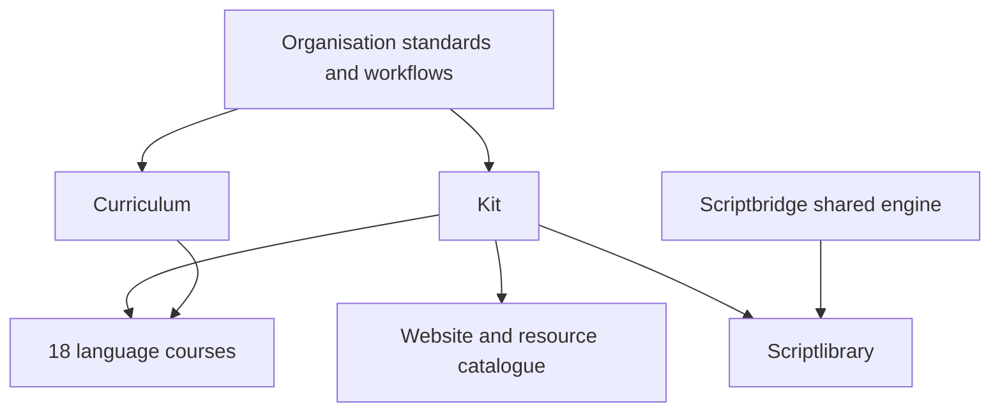

# Boulingua suite

Boulingua serves language teachers and learners, particularly in German schools.
S. Le Boulanger authors the teaching content. Shared engineering supports
consistent teaching pages, printable materials, recordings, provenance and
reviewed curriculum mappings.

| Layer | Repositories | Responsibility and current scope |
|---|---|---|
| Standards and release coordination | `.github` | Architecture decisions, repository roles, reusable workflows and suite audit |
| Teaching platform | `kit` | Shared Hugo components, tokens/fonts, PDF/audio generation, gates and authoring tools |
| Framework | `curriculum` | Stable descriptor IDs, traceable mappings and coverage resolution; source omissions remain blockers |
| Existing courses | `efl`, `fle`, `daf` | 180, 156 and 60 units respectively; materials exist, educational/audio release findings remain |
| Development courses | `afl`, `cfl`, `ele`, `gfl`, `ils`, `jfl`, `lle`, `nsf`, `nvt`, `pfa`, `pfl`, `ple`, `rki`, `tfl`, `ufl` | Buildable German-interface course sites; no teaching release yet |
| Discovery | `website`, `ressources` | Suite navigation and a trilingual external-resource catalogue |
| Reading practice | `scriptbridge`, `scriptlibrary` | Shared deterministic alphabet practice in an extension and a library of original-language books |
| Historical generators | `pagegen`, `slidegen`, `sheetgen`, `audiogen` | Archived references; maintained successors are in kit |

The extension/library practise selected script correspondences. They do not
translate text, establish pronunciation equivalence or certify a learner's level.
Their product workflows are distinct from course workflows; the shared engine
and packaged extension are protected by digest checks.

A release requires both working software and reviewed teaching evidence.
An empty but functional course shell must remain labelled as development.
Proposed descriptor mappings do not become asserted merely because they parse.
Voice recordings can be created locally or by a human, but actual review records
must identify the recording/model, speaker, reviewer and date. Deferred script
tiers and the Latin scope follow the accepted architecture decisions.

The current implementation/audit record is
[refinement-2026-10-30.md](refinement-2026-10-30.md). No local test establishes a
successful hosted CI run, published release, deployment or educational approval.
